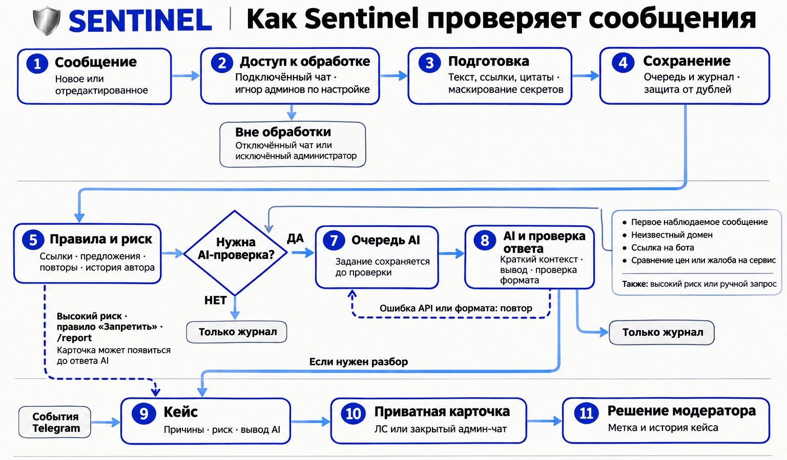

# Sentinel

Sentinel помогает модераторам разбирать сообщения в Telegram-группах. Бот проверяет ссылки, ищет рекламу, фишинг и предложения, запрещённые правилами конкретного чата. Когда требуется разобраться в смысле сообщения, подключает AI.

Результат разбора приходит в карточке: фрагмент сообщения, ссылка на оригинал, причины проверки, оценка риска и вывод AI. Модератор может отметить нарушение, отклонить подозрение или оставить кейс на проверку. История решений сохраняется.

## Как проходит проверка

1. Бот получает сообщение из подключённой группы. Обрабатывает и новые сообщения, и правки. При подключении через бота сбор начинается после подтверждения группы. Сообщения администраторов можно исключить отдельной настройкой.

2. Подготавливает текст и ссылки. Читает также подписи к медиа, скрытые ссылки и цитаты. Маскирует распознаваемые ключи, токены и пароли. Сохраняет сообщение в очередь и журнал, чтобы продолжить обработку после перезапуска. Повторная доставка того же обновления не создаёт новую проверку.

3. Проверяет правила чата. Отдельные модули ищут реферальные ссылки, рекламу, продажи, раздачи, предложения услуг и поиск клиентов. Учитывают повторы сообщений и наблюдаемую активность автора. Найденные признаки складываются в оценку риска от 0 до 100; накопленное доверие может её снизить.

4. Решает, нужен ли AI. Четыре основных повода для обязательной проверки: первое сообщение автора, которое бот увидел в этом чате; неизвестный внешний домен; ссылка на бота; сравнение цен или жалоба на сервис. Доверие и лимит дополнительных запросов эти проверки не отменяют. Неполный разбор ссылок тоже требует проверки. Дополнительно AI подключается при высоком риске, по команде администратора и, по умолчанию, при жалобе `/report`. Сообщение без поводов для дальнейшего разбора остаётся в журнале.

5. Передаёт AI короткий контекст. В запрос входят сообщение, найденные признаки, доступный ответ на другую реплику и несколько соседних сообщений. Модель определяет категорию, объясняет вывод и предлагает дальнейшее действие. Бот проверяет формат и допустимые значения ответа. Если API недоступен или ответ некорректен, обязательное задание остаётся в очереди для повтора.

6. Создаёт или обновляет кейс. Высокий риск, совпадение с правилом в режиме «Запретить» или жалоба могут открыть кейс ещё до ответа AI. Если проверка назначена, карточка сначала показывает ожидание, затем обновляется результатом. Вывод AI тоже может стать поводом для нового кейса. Связанные сообщения могут объединяться в один разбор; результат без повода для уведомления сохраняется без новой карточки.

7. Отправляет карточку в ЛС или закрытый админ-чат. Модератор видит причины и контекст, выбирает решение кнопкой, а бот сохраняет метку в истории кейса. Полученные от Telegram события смены статуса участника дополняют кейс; связь события с конкретным сообщением можно указать вручную.



## Запуск на Ubuntu VPS

Нужны Docker Engine и Compose v2. Для разработки: Go 1.27.3 (минимум 1.26), PostgreSQL 17.

```bash
git clone https://github.com/crewyyyy/sentinel.git sentinel
cd sentinel
cp deploy/.env.example deploy/.env
chmod 600 deploy/.env
cp configs/config.example.yaml configs/config.yaml
openssl rand -hex 24  # вставьте результат как POSTGRES_PASSWORD
```

1. Создайте бота через BotFather.
2. В YAML укажите числовые `admin_chat_id` и `allowed_admin_ids`. Для ЛС оба относятся к одному пользователю; закрытый админ-чат должен быть отдельным от наблюдаемых групп. Оставьте `chat_ids: []` и `auto_discover_chats: true` для подключения через бота.
3. В `deploy/.env` заполните `TELEGRAM_BOT_TOKEN`, `POSTGRES_PASSWORD`, `AI_BASE_URL`, `AI_MODEL`, `AI_API_KEY`. Включите `/v1` в URL, если этого требует провайдер. Модель должна поддерживать Chat Completions, `response_format=json_object`, `temperature` и `max_tokens`.

```bash
docker compose --env-file deploy/.env -f deploy/compose.yaml up -d db
docker compose --env-file deploy/.env -f deploy/compose.yaml build sentinel
docker compose --env-file deploy/.env -f deploy/compose.yaml run --rm sentinel validate --config /app/configs/config.yaml
docker compose --env-file deploy/.env -f deploy/compose.yaml run --rm sentinel migrate
docker compose --env-file deploy/.env -f deploy/compose.yaml up -d sentinel
docker compose --env-file deploy/.env -f deploy/compose.yaml logs --tail=100 sentinel
docker compose --env-file deploy/.env -f deploy/compose.yaml ps
```

Один токен обслуживает один poller. Существующий webhook нужно удалить перед запуском, сохранив pending updates.

## Подключить группу

1. Отправьте боту `/start`, выберите «Подключить чат».
2. Добавьте бота администратором без прав `can_restrict_members` и `can_delete_messages`.
3. Уведомите участников об обработке сообщений и внешнем AI. Нажмите «Подключить» в заявке, которую бот пришлёт в ЛС.

Сбор начинается после подтверждения. История до подключения недоступна. Подробности: [подключение](docs/chat-onboarding.md), [ограничения Bot API](docs/telegram-limitations.md).

Для проверки напишите сообщение в тестовой группе, затем ответьте на него `/report причина`. Администратору должна прийти карточка. Проверьте `/status` и health:

```bash
docker compose --env-file deploy/.env -f deploy/compose.yaml exec sentinel sentinel healthcheck
```

Если сообщения не приходят, проверьте статус администратора и Privacy Mode в BotFather; после его изменения переподключите бота. Для проверки `chat_member` измените права отдельного тестового участника. [Диагностика](docs/operations.md).

## Управление

`/start` открывает меню с баннером; переходы меняют подпись и кнопки того же сообщения. В «Модулях» выберите чат, настройте продажи, раздачи, услуги и поиск клиентов. Словари и дополнительные параметры открываются отдельно; изменения требуют сохранения и подтверждения. [Настройка модулей](docs/chat-modules.md).

В группе жалобы принимаются ответом на сообщение: `/report`, `/report@your_bot`, `!репорт`, `!report`. Дополнительные жалобы сверх пяти в час сохраняются в очереди `/reports`.

`moderation.ignore_admin_messages: true` исключает сообщения владельца и администраторов группы из автоматического анализа и журнала, включая анонимного администратора. Команды, кнопки и явные жалобы `/report` работают. При отсутствии параметра игнор выключен. После изменения нужен перезапуск бота; прежние кейсы и задания сохраняются.

Команды администратора работают в разрешённом ЛС или закрытом админ-чате:

| Команда | Действие |
|---|---|
| `/start`, `/chats` | Главное меню, список чатов и заявки |
| `/status`, `/stats` | Состояние и очереди |
| `/model [поиск]`, `/models [поиск]` | Выбор модели AI |
| `/modules [CHAT_ID]` | Правила выбранного чата |
| `/modulewords PANEL_ID MATCHER MODE слова \| фразы` | Заменить словарь в черновике |
| `/modulelimit PANEL_ID KEY N` | Изменить параметр в черновике |
| `/case ID` | Открыть кейс |
| `/reports [CHAT_ID]`, `/reportcase REPORT_ID` | Жалобы и их кейсы |
| `/feedback ID benign\|spam\|false_positive\|needs_review\|close [текст]` | Сохранить решение |
| `/resolve CASE_ID benign\|spam\|false_positive [текст]` | Разрешить конфликт меток |
| `/review ID` | Запросить AI-проверку |
| `/attest ID warn\|ban\|restrict\|delete [текст]` | Записать действие со слов администратора |
| `/link CASE_ID EVENT_DB_ID` | Связать кейс с событием из `moderation_events` |
| `/tune`, `/forget` | Настройки и инструкция удаления данных |

## Фото, GIF и стикеры

Включите `media.enabled: true` в YAML и задайте `FAL_KEY` в `deploy/.env`. Модель `fal-ai/imageutils/nsfw` проверяет фото, GIF, стикеры и кастомные Premium emoji отдельно от текстового AI.

В личке отправьте медиа с аккаунта из `allowed_admin_ids`: бот ответит на него коротким реплаем с оценкой NSFW. Заголовок использует Premium custom emoji: подтверждение, проверка или высокий риск. В подключённых группах подозрительный результат попадает в приватную карточку кейса.

Одинаковый стикер использует сохранённый результат до 30 дней, в том числе после перезапуска. Второй кэш распознаёт одинаковые кадры под разными file IDs. По умолчанию доступно 200 запросов к модели в сутки; кадры расходуют лимит отдельно. При исчерпании лимита новые проверки ждут, а кэш продолжает работать.

GIF и видеостикеры проверяются по выборке до трёх кадров. Для TGS-анимации проверяется только Telegram-превью, что указано в ответе. Это не проверка всех кадров. При включении уведомите участников о передаче изображений в fal.ai. [Настройка, ограничения и откат](docs/media-moderation.md).

## AI и хранение

`/model` сохраняет выбор для всех чатов; нужны права администратора во всех них. Поиск: `/model luna`. Изменение действует на новые попытки, включая повторы. [Модели и доступ к каталогу](docs/runtime-models.md).

При `ai.enabled: false` задания ждут в очереди. Лимит дополнительных запросов задаётся на сутки UTC; лимитов по токенам и деньгам пока нет. Стоимость рассчитывается при наличии usage и заданных цен.

Журнал: до 1000 сообщений на чат и до 7 дней. Остальные сроки, резервные копии и удаление данных описаны в [политике хранения](docs/privacy.md). Не публикуйте `.env`, реальные IDs, дампы, dataset и session-файлы. Health, metrics и PostgreSQL доступны только внутри сети Compose.

## Разработка

```bash
make setup
make test
make lint
make race
make inspect  # нормализация и риск без AI
make build
```

Интеграционные тесты требуют отдельной БД с правами CREATE/DROP SCHEMA. Без `TEST_DATABASE_URL` они пропускаются. Не используйте production.

```bash
docker run -d --name sentinel-test-db \
  -e POSTGRES_HOST_AUTH_METHOD=trust -e POSTGRES_DB=sentinel_test \
  -p 127.0.0.1:55432:5432 postgres:17-alpine
export TEST_DATABASE_URL='postgres://postgres@127.0.0.1:55432/sentinel_test?sslmode=disable'
make integration
# Остановить и удалить только созданную выше тестовую БД:
docker stop sentinel-test-db
docker rm sentinel-test-db
```

Тесты используют fake Telegram/AI. Для проверки декодирования медиа установите `ffmpeg` (`sudo apt-get install ffmpeg`); без него эти тесты пропускаются. В Docker и CI он установлен. CI запускает PostgreSQL, race, vet и сборку образа. Для запуска без Docker задайте `DATABASE_URL`, `TELEGRAM_BOT_TOKEN`, `AI_*` в окружении и выполните `make run`: приложение само `.env` не читает. Не включайте shell tracing с секретами.

## Документация

- [Архитектура](docs/architecture.md), [решения](docs/decisions/0001-bot-api-mvp.md).
- [Модули анализа и добавление детекторов](docs/analysis-modules.md).
- [Backup, restore, обновление и rollback](docs/operations.md).
- [Экспорт и replay](docs/tuning.md).
- [Реализованное и оставшиеся задачи](docs/implementation-status.md).
- [Оформление карточек и Premium](docs/telegram-limitations.md#оформление-карточек).
